<!-- Header -->

  

  

  
  
  
  

---

## 👨‍💻 About me

I'm a **Full Stack Developer** who has been building software since **2021**, with a degree in **Systems Analysis and Development (2023)**. I like owning a product end to end: architecture, backend, frontend, infrastructure and the business problem behind it. More and more, that includes making the product **AI-maintainable** for the people who run it.

- 🏦 **Now** — Full Stack Developer at **[Sparta](https://www.sparta.com.br/fundos/)** (fund management), mostly **Python** and **React**. I joined as a Frontend Developer and moved to full stack, working on business-critical apps with a focus on performance, code quality and reliability.
- 🤖 **AI-ready delivery** — I build applications end to end so that **non-technical managers can maintain them with AI**: architecture, docs and guardrails that let an AI assistant work safely on the codebase, plus the **infrastructure** to run it all. Delivered this way for **Decmetal** and **VidelTel**.
- 🐉 **After hours** — building **Roxly**, a live MMORPG, from the C++ engine to the launcher, tooling and production servers.
- 🧠 **How I work** — technical depth + product thinking + business awareness. I ship things that solve the real problem.

<b>📍 Career timeline</b>

 

| When | Where | What |
|---|---|---|
| **Oct 2025 → now** | Sparta | Full Stack Developer (Python + React), joined as Frontend Developer: business-critical applications for a fund manager |
| **2025** | VidelTel Logistics & Transportation | Full Stack: freight planning platform, delivered AI-ready with the infrastructure to run it |
| **2025** | Liga Nacional de Taekwondo | Full Stack: led the official platform, from architecture and business analysis to delivery |
| **2021 → 2025** | Freelance | APIs, dashboards, internal systems and custom web apps for mid-sized companies |
| **2021 → 2024** | [Modpacks](https://modpacks.com.br) | Founder: curated Skyrim modpack with its own website, wiki, Discord community and a supporter-only installer |
| **2022 → 2023** | Ambev / AB InBev | IT & DevOps (1 yr 8 mo): Node.js, automation, infrastructure, support for critical systems |
| **2023** | Rocketseat · College | React & Node.js professional training · Systems Analysis and Development degree |

---

## 🛠️ Tech stack

<table align="center">
  <tr>
    <td align="center" width="140"><b>Frontend</b></td>
    <td></td>
  </tr>
  <tr>
    <td align="center"><b>Backend</b></td>
    <td></td>
  </tr>
  <tr>
    <td align="center"><b>Infra & DevOps</b></td>
    <td></td>
  </tr>
  <tr>
    <td align="center"><b>Desktop, games & systems</b></td>
    <td></td>
  </tr>
</table>

---

## 🚀 Featured work

> Most of these live in private repositories. Happy to walk through any of them.

<table>
  <tr>
    <td width="50%" valign="top">
      <h3>🐉 Roxly — live MMORPG</h3>
      An MMORPG in closed beta, built on a legacy C++ codebase. I ported the server from FreeBSD to Linux and run it in Docker in production. On the client I upgraded the renderer (Direct3D 9Ex, volumetric clouds, dynamic weather, procedural grass, shadows) and built dozens of gameplay systems end to end in C++, Python UI and Lua quests.
        
      
      
      
      
      
    </td>
    <td width="50%" valign="top">
      <h3>🛰️ Roxly Launcher</h3>
      Desktop launcher and auto-updater. Signed manifests, incremental per-file delivery, integrity verification and self-update. Players' settings are never overwritten. A local publishing assistant turns a release into a guided prepare → review → publish → verify flow.
        
      
      
      
      
    </td>
  </tr>
  <tr>
    <td width="50%" valign="top">
      <h3>🧰 Roxly Studio</h3>
      Desktop CMS for the game's data: CMS-style editors for items, monsters, drops, shops, dungeons and the in-game cash shop, plus a remote panel that deploys to the production server on save.
        
      
      
      
      
    </td>
    <td width="50%" valign="top">
      <h3>🥋 Liga Nacional de Taekwondo</h3>
      The league's official platform, built full stack: registrations, events and championship management, with containerized deployment behind Nginx.
        
      
      
      
      
    </td>
  </tr>
  <tr>
    <td width="50%" valign="top">
      <h3>🚚 VidelTel Freight Planner</h3>
      Freight planning tool for VidelTel Logistics & Transportation. It turns the company's day-to-day logistics process into a web app, delivered **AI-ready** so the team can maintain it with AI, on infrastructure I provide.
        
      
      
      
      
      
    </td>
    <td width="50%" valign="top">
      <h3>🤖 Community bots & modding</h3>
      Discord bots for the Roxly and Modpacks Reborn communities: wiki lookup, support, bug reports, announcements, polls and anti-spam. I also built the <b><a href="https://modpacks.com.br">MaxTR Skyrim modpack</a></b> (2021 → 2024) and its supporter installer.
        
      
      
      
    </td>
  </tr>
</table>

---

## 📊 GitHub activity

  <picture>
    <source media="(prefers-color-scheme: dark)" srcset="https://raw.githubusercontent.com/Maxtherox/maxtherox/output/overview-dark.svg"/>
    <source media="(prefers-color-scheme: light)" srcset="https://raw.githubusercontent.com/Maxtherox/maxtherox/output/overview-light.svg"/>
    
  </picture>
  <picture>
    <source media="(prefers-color-scheme: dark)" srcset="https://raw.githubusercontent.com/Maxtherox/maxtherox/output/languages-dark.svg"/>
    <source media="(prefers-color-scheme: light)" srcset="https://raw.githubusercontent.com/Maxtherox/maxtherox/output/languages-light.svg"/>
    
  </picture>

  <picture>
    <source media="(prefers-color-scheme: dark)" srcset="https://raw.githubusercontent.com/Maxtherox/maxtherox/output/activity-dark.svg"/>
    <source media="(prefers-color-scheme: light)" srcset="https://raw.githubusercontent.com/Maxtherox/maxtherox/output/activity-light.svg"/>
    
  </picture>

  <picture>
    <source media="(prefers-color-scheme: dark)" srcset="https://raw.githubusercontent.com/Maxtherox/maxtherox/output/snake-dark.svg"/>
    <source media="(prefers-color-scheme: light)" srcset="https://raw.githubusercontent.com/Maxtherox/maxtherox/output/snake-light.svg"/>
    
  </picture>

Cards are generated daily by a GitHub Action in this repo, with no third-party stats server involved.

<!-- Footer -->

  

